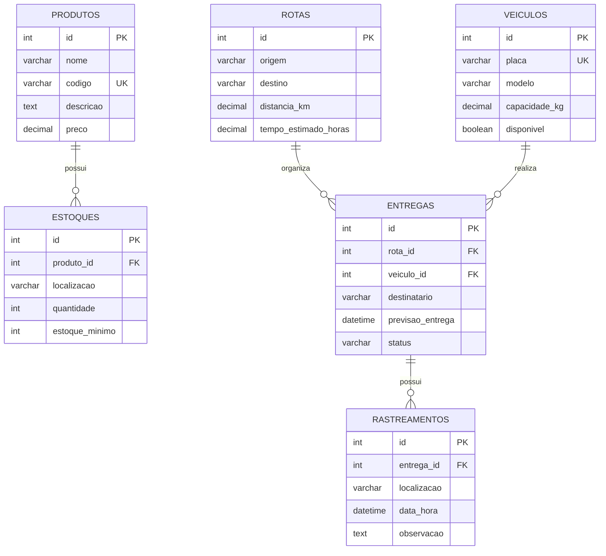

# Modelo de domínio — Logística e Cadeia de Suprimentos

## 1. Objetivo do domínio

A API organiza informações usadas em operações de logística e cadeia de suprimentos: produtos armazenados, níveis de estoque, veículos, rotas de transporte, entregas e eventos de rastreamento.

O modelo possui seis entidades persistidas no PostgreSQL: `Produto`, `Estoque`, `Veiculo`, `Rota`, `Entrega` e `Rastreamento`. As tabelas são criadas pela migration do Alembic em `app/alembic/versions/6ed0c1266c81_initial_schema.py`.

## 2. Entidades e atributos

Os tipos e as colunas abaixo refletem os modelos SQLAlchemy e a migration atual. As validações de entrada são aplicadas pelos schemas Pydantic. Quando uma regra aparece apenas como validação do schema, isso não significa necessariamente que exista uma restrição `CHECK` no banco de dados.

### 2.1 Produto

Representa um item armazenado ou transportado pela operação logística.

| Atributo | Tipo Python / SQL | Coluna | Obrigatório | Regra atual |
|---|---|---|---|---|
| `id` | `int` / `INTEGER` | `id` | Sim | Chave primária, gerada pelo banco. |
| `nome` | `str` / `VARCHAR(100)` | `nome` | Sim | De 1 a 100 caracteres; espaços nas extremidades são removidos e o valor não pode ficar vazio. |
| `codigo` | `str` / `VARCHAR(30)` | `codigo` | Não | Até 30 caracteres; único quando informado; não pode conter apenas espaços. |
| `descricao` | `str` / `TEXT` | `descricao` | Não | Texto livre. |
| `preco` | `Decimal` / `NUMERIC(10,2)` | `preco` | Sim | Deve ser maior que zero e ter no máximo duas casas decimais. |

### 2.2 Estoque

Representa a quantidade disponível de um produto em um local de armazenamento.

| Atributo | Tipo Python / SQL | Coluna | Obrigatório | Regra atual |
|---|---|---|---|---|
| `id` | `int` / `INTEGER` | `id` | Sim | Chave primária, gerada pelo banco. |
| `produto_id` | `int` / `INTEGER` | `produto_id` | Sim | Chave estrangeira para `produtos.id`; o Service verifica se o produto existe. |
| `localizacao` | `str` / `VARCHAR(100)` | `localizacao` | Sim | De 1 a 100 caracteres; não pode conter apenas espaços. |
| `quantidade` | `int` / `INTEGER` | `quantidade` | Sim | Deve ser maior ou igual a zero; valor padrão no modelo/schema: `0`. |
| `estoque_minimo` | `int` / `INTEGER` | `estoque_minimo` | Sim | Deve ser maior ou igual a zero; valor padrão no modelo/schema: `0`. |

### 2.3 Veículo

Representa um veículo utilizado para transportar mercadorias.

| Atributo | Tipo Python / SQL | Coluna | Obrigatório | Regra atual |
|---|---|---|---|---|
| `id` | `int` / `INTEGER` | `id` | Sim | Chave primária, gerada pelo banco. |
| `placa` | `str` / `VARCHAR(10)` | `placa` | Sim | De 1 a 10 caracteres; normalizada para maiúsculas; única no banco. |
| `modelo` | `str` / `VARCHAR(100)` | `modelo` | Sim | De 1 a 100 caracteres; não pode conter apenas espaços. |
| `capacidade_kg` | `Decimal` / `NUMERIC(10,2)` | `capacidade_kg` | Sim | Deve ser maior que zero e ter no máximo duas casas decimais. |
| `disponivel` | `bool` / `BOOLEAN` | `disponivel` | Sim | Valor padrão da aplicação: `true`. |

### 2.4 Rota

Representa um percurso de transporte entre uma origem e um destino.

| Atributo | Tipo Python / SQL | Coluna | Obrigatório | Regra atual |
|---|---|---|---|---|
| `id` | `int` / `INTEGER` | `id` | Sim | Chave primária, gerada pelo banco. |
| `origem` | `str` / `VARCHAR(100)` | `origem` | Sim | De 1 a 100 caracteres; não pode conter apenas espaços. |
| `destino` | `str` / `VARCHAR(100)` | `destino` | Sim | De 1 a 100 caracteres; não pode conter apenas espaços. |
| `distancia_km` | `Decimal` / `NUMERIC(10,2)` | `distancia_km` | Sim | Deve ser maior que zero e ter no máximo duas casas decimais. |
| `tempo_estimado_horas` | `Decimal` / `NUMERIC(10,2)` | `tempo_estimado_horas` | Não | Quando informado, deve ser maior que zero e ter no máximo duas casas decimais. |

### 2.5 Entrega

Representa uma entrega destinada a um destinatário, vinculada a uma rota e a um veículo.

| Atributo | Tipo Python / SQL | Coluna | Obrigatório | Regra atual |
|---|---|---|---|---|
| `id` | `int` / `INTEGER` | `id` | Sim | Chave primária, gerada pelo banco. |
| `rota_id` | `int` / `INTEGER` | `rota_id` | Sim | Chave estrangeira para `rotas.id`; o Service verifica se a rota existe. |
| `veiculo_id` | `int` / `INTEGER` | `veiculo_id` | Sim | Chave estrangeira para `veiculos.id`; o Service verifica se o veículo existe. |
| `destinatario` | `str` / `VARCHAR(100)` | `destinatario` | Sim | De 1 a 100 caracteres; não pode conter apenas espaços. |
| `previsao_entrega` | `datetime` / `DATETIME` | `previsao_entrega` | Não | Data/hora válida, no formato aceito pelo Pydantic. |
| `status` | `str` / `VARCHAR(100)` | `status` | Sim | De 1 a 100 caracteres; não pode conter apenas espaços. O código atual não restringe o campo a uma lista fechada de status. |

### 2.6 Rastreamento

Registra uma localização e uma atualização associada a uma entrega.

| Atributo | Tipo Python / SQL | Coluna | Obrigatório | Regra atual |
|---|---|---|---|---|
| `id` | `int` / `INTEGER` | `id` | Sim | Chave primária, gerada pelo banco. |
| `entrega_id` | `int` / `INTEGER` | `entrega_id` | Sim | Chave estrangeira para `entregas.id`; o Service verifica se a entrega existe. |
| `localizacao` | `str` / `VARCHAR(200)` | `localizacao` | Sim | De 1 a 200 caracteres; não pode conter apenas espaços. |
| `data_hora` | `datetime` / `DATETIME` | `data_hora` | Sim | Data/hora válida, no formato aceito pelo Pydantic. |
| `observacao` | `str` / `TEXT` | `observacao` | Não | Texto livre; se for enviado apenas com espaços, o schema transforma o valor em `null`. |

## 3. Relacionamentos

| Entidade de origem | Entidade relacionada | Cardinalidade | Chave estrangeira |
|---|---|---|---|
| `Produto` | `Estoque` | Um produto pode ter zero ou vários registros de estoque; cada estoque pertence a um produto. | `estoques.produto_id` → `produtos.id` |
| `Rota` | `Entrega` | Uma rota pode estar associada a zero ou várias entregas; cada entrega usa uma rota. | `entregas.rota_id` → `rotas.id` |
| `Veiculo` | `Entrega` | Um veículo pode estar associado a zero ou várias entregas; cada entrega referencia um veículo. | `entregas.veiculo_id` → `veiculos.id` |
| `Entrega` | `Rastreamento` | Uma entrega pode ter zero ou vários registros de rastreamento; cada registro pertence a uma entrega. | `rastreamentos.entrega_id` → `entregas.id` |

## 4. Diagrama ER

`||--o{` representa um relacionamento de um para muitos. Por exemplo, uma entrega pode ter vários registros de rastreamento, mas cada registro de rastreamento referencia uma única entrega.

## 5. Persistência e migrations

O banco utilizado é PostgreSQL. A estrutura inicial das seis tabelas está versionada em `app/alembic/versions/6ed0c1266c81_initial_schema.py` e é gerenciada pelo Alembic. A migration cria as chaves primárias, as chaves estrangeiras e as restrições de unicidade de `produtos.codigo` e `veiculos.placa`.

As validações de valores, como preço positivo, quantidade não negativa e localização não vazia, estão nos schemas Pydantic. Na migration atual, esses critérios não aparecem como restrições `CHECK` no banco; portanto, a API deve continuar validando os dados antes de gravá-los.
